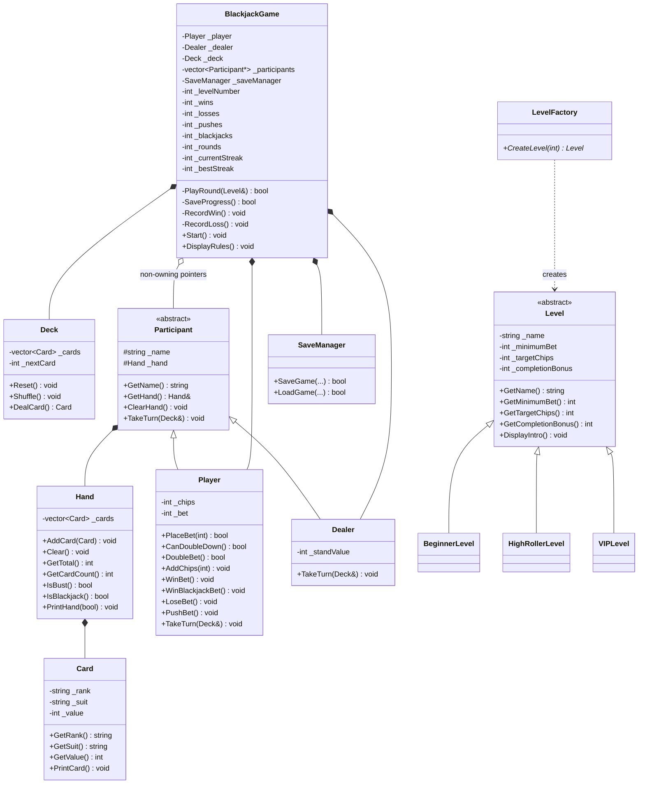

# Blackjack class diagram

## Design notes

- `Participant` is abstract because `TakeTurn()` is pure virtual. `Player` and `Dealer` override it.
- `Level` is abstract because `DisplayIntro()` is pure virtual. Each concrete level supplies its own introduction and settings.
- `LevelFactory::CreateLevel()` follows the Factory Method example from the lecture notes: it chooses a concrete level and returns it through a base-class pointer.
- `BlackjackGame` owns the `Level*` returned by the factory and deletes it when the level is finished or the game returns to the title screen.
- The `vector<Participant*>` in `BlackjackGame` is non-owning: it only points to `_player` and `_dealer`, which are member objects owned by `BlackjackGame`.
- Cards are stored by value in the deck and hands. This avoids unnecessary `new` and `delete` for ordinary card objects.
- `SaveManager` stores the player's chips, level, round record and streak statistics in a text file.
